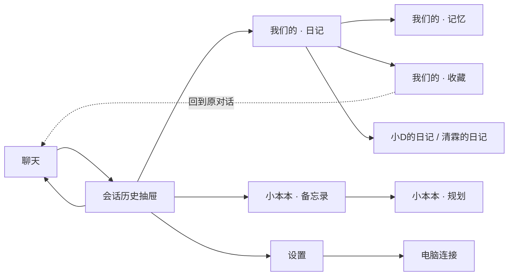

# 小家 · 完整交互逻辑

本文描述 `index.html` 原型的全部页面、状态与交互规则。原型是纯静态单文件，示例回复、思考流、电脑在线状态、导出等均为演示实现，接真实模型/系统能力时按同一条交互保留。

## 页面地图

## 1. 全局导航

- 页面用 hash 路由：`#chat`、`#diary`、`#memory`、`#favorites`、`#notes`、`#plan`、`#settings`、`#connection`、`#single`。未知 hash 回到聊天。
- 二级页左上角返回：
  - 普通二级页返回聊天。
  - 从「我们的」进入某人日记，返回「我们的 · 日记」。
  - 从会话历史抽屉进入任意页面，返回后抽屉自动重新打开。
- 抽屉打开时：背景 `.app` 设为 `inert`，点遮罩关闭，Esc 关闭；焦点限制在抽屉内循环。
- 切换页面时记住每个页面的滚动位置。
- 浏览器前进/后退（popstate / hashchange）按 hash 还原页面。
- 手机壳预览 `preview.html`：412×917，自动缩放；iframe 通过 `postMessage` 告诉外壳模型浮层/二级页状态，用来切换状态栏和手势条底色。

## 2. 聊天

### 2.1 空态

没有消息时显示表情和一句问候，按当前小时切换：

| 时间 | 表情 | 文案 |
| --- | --- | --- |
| 23:00–05:59 | ←_← | 还不睡觉 |
| 06:00–07:59 | ↑_↑ | 醒这么早 |
| 08:00–10:59 | →_→ | 上午好 |
| 11:00–12:59 | ←_← | 吃点什么 |
| 13:00–16:59 | ↓_↓ | 有点困 |
| 17:00–18:59 | →_→ | 天快黑了 |
| 19:00–22:59 | ↑_↑ | 晚上好 |

### 2.2 输入与发送

输入框右下角的发送键常驻，状态如下：

| 状态 | 发送键 | 停止键 |
| --- | --- | --- |
| 空闲、无文字 | 灰色，不可点 | 隐藏 |
| 空闲、有文字 | 橙色，可点 | 隐藏 |
| 生成中、无文字 | 隐藏 | 显示 |
| 生成中、有文字 | 橙色，可点 | 隐藏 |

- Enter 发送，Shift+Enter 换行；输入法组合中（isComposing）不发送。
- 输入框高度随内容增长，最高 135px。
- 发送后：写入用户消息（时间取当前 HH:mm），首条消息用前 22 个字做会话标题，会话日期更新为今天。
- 生成中继续发送：新消息标为「排队中」，当前回复结束后按顺序逐条发送。
- 切换会话会清空输入框（原型未做草稿保存）。

### 2.3 生成过程

1. 用户消息上屏后，AI 消息占位。
2. 显示「正在思考」约 900ms（未开启思考时约 550ms）。
3. 开启思考：先逐字流式显示思考过程，结束后折叠为「想了想 N 秒 · 展开」；再逐字流式显示正文。
4. 生成中滚动：如果用户没有主动上翻，自动跟随到底部。
5. 停止：只停止当前会话这一条回复，已生成的部分保留；排队消息继续下一条。
6. 回复结束自动持久化；空回复会被移除。

上下文占用（原型演示，不是真 token）：所有消息字数 ÷ 80，四舍五入，最高 99%。≥70% 橙色，≥90% 深棕色。

### 2.4 消息操作

长按消息约 520ms（移动超过 8px 取消）或右键消息，打开操作菜单；桌面端也可以用每条消息右侧的 `⋮`。

| 操作 | 用户消息 | AI 消息 | 规则 |
| --- | --- | --- | --- |
| 复制 | ✓ | ✓ | 剪贴板不可用时弹出手动复制框 |
| 选择文本 | ✓ | ✓ | 弹出只读文本框 |
| 收藏 | ✓ | ✓ | 写入收藏；再次点击取消 |
| 编辑 | ✓ | — | 保存后截断该消息之后的内容并重新生成 |
| 重新生成 | — | ✓ | 直接替换当前 AI 回复，位置不变 |
| 收入日记 | ✓ | ✓ | 打开写日记表单，正文预填，作者为清霖，日期今天，标题必填 |
| 删除 | ✓ | ✓ | 删除用户消息会连带删除紧随其后的 AI 回复 |
| 多选 | ✓ | ✓ | 进入多选模式 |

- 思考折叠按钮点开查看完整思考过程。
- 消息被收藏后，星标状态在聊天和收藏页之间同步。

### 2.5 多选模式

- 入口：任意消息菜单 →「多选」。
- 顶栏变为：左 ×、中间「已选 N 条」、右「全选 / 取消全选」。
- 消息区左右留白加大；每条消息外侧出现选择圈，用户和 AI 消息都可以勾选。
- 点消息任意位置切换选中；键盘 Space / Enter 也可切换。
- 底部两个圆形图标：删除、导出。
  - 未选中任何消息时两个按钮禁用。
  - 删除：确认后删除选中的消息（精确删除所选，不额外配对），完成后退出多选，Toast 提供 5 秒内撤销。
  - 导出：打开选择浮层，选「图片（长图）」或「文档（文字）」。当前是原型占位说明，不生成文件。
- 退出：点 ×、按 Esc、切换页面/会话、新建对话。
- 多选模式隐藏输入框和消息工具。

### 2.6 回到原对话

- 收藏里的对话条目点开后有「回到原对话」。
- 点击后关闭收藏浮层，切到原会话，滚到那条消息并高亮约 1.8 秒。
- 原会话或消息已不存在时，浮层显示「原对话已不在了」，不提供跳转。

## 3. 会话历史抽屉

- 入口：聊天顶栏左上角。
- 搜索：匹配会话标题和全部消息正文。
- 分组：7 天内 / 30 天内 / 年月；置顶会话单独一组排在最前。
- 时间显示：今天 / N 天前 / N 日（超过 30 天）。
- 当前会话高亮；当前行右侧时间位置换成 `•••`，点开菜单：重命名 / 置顶（取消置顶）/ 删除。
- 删除会话：5 秒内可撤销；删除当前会话会回到新对话空态。
- 点其他会话：只切换背后的聊天，抽屉保持打开；从抽屉进入其他页面，返回后抽屉恢复。
- 多选：标题右侧多选图标进入选择模式；搜索和底部导航隐藏；勾选后底部批量「置顶 / 删除」，删除可撤销；× 或 Esc 退出。

## 4. 我们的

### 4.1 日记时间轴

- 按日期倒序，两个作者（小D / 清霖）共用一条时间轴。
- 作者名在卡片外，圆点在时间轴外侧；小D 在左，清霖在右。
- 日记卡片固定 100px：3 行摘要、底部白色渐隐、「⌄ 展开全部」。
- 未读日记作者名后带「· 新」；读过即清除，抽屉底部的小红点随未读消失。

日期尺：

- 范围从最早一篇日记到最近一篇（最多今天）；每格 32px，显示 ±10 格。
- 鼠标拖动、滚轮、左右方向键、PageUp/PageDown、Home/End 都可滑动。
- 松手吸附到中间日期；有日记的日期刻度更深。
- 选择日期后滚动到当天第一篇日记。

日历：

- 每月网格，蓝色点＝小D写了，绿色点＝清霖写了，今天带圆环。
- 可翻上月/下月；选日期后「查看」跳到日记页对应位置；当天没有日记时提示。

### 4.2 阅读纸卡

- 点日记卡片打开 330px 宽的浮动纸卡，最大高度 486px。
- 高度随内容变化；正文超过最大高度时，正文区域内部上下滚动。
- 左上角作者标签骑在纸卡上沿；标题 + 日期 + 12px/15px 正文。
- 底部右侧三个图标：编辑（铅笔）、收藏（星）、删除（垃圾桶）。
- 收藏后星标填橙；编辑保存后纸卡同步刷新；删除关闭纸卡。
- 点遮罩、右上角 × 或 Esc 关闭。
- 正文从长到短时高度回缩；不做固定高度占位。

### 4.3 写 / 编辑日记

- 入口：日记页右下角橙色＋；或任意消息「收入日记」。
- 字段：日期（最大今天）、标题（40 字）、正文（6000 字），均必填。
- 保存后：写入对应日期，回到日记页并滚到这篇；标题为空不保存。
- 编辑保留原作者和 id；删除需要确认，删除后不回填草稿。

### 4.4 单人日记页

- 点作者名进入该作者的按月分组列表。
- 卡片显示标题、收藏星标、日期。
- 返回回到「我们的 · 日记」。

### 4.5 记忆

- 开关：记忆总开关、参考历史聊天记录。
- 基础提示词：单行输入，保存到设置状态。
- 管理记忆：列表 + 添加/编辑/删除；删除需要确认。

### 4.6 收藏

- 分类：日记 / 对话，用左侧色条区分；日记卡更高。
- 每张卡右上角显示分类、日期、时间。
- 点开查看全文；取消收藏后卡片立即消失。
- 预置 4 条收藏，只在首次加载时播种；用户删掉后不会再次出现。
- 对话收藏支持「回到原对话」（见 2.6）。

## 5. 小本本

### 5.1 备忘录

- 分「今日 / 本周 / 长期」三组，每组带固定行数的横线纸。
- 条目：勾选圈、文字、右侧删除 ×。
- 勾选：立即划线并保存；再点取消。
- 点文字：编辑；右上角＋：新增到该组；×：删除，需确认。
- 所有修改写入 localStorage，刷新保留。

### 5.2 规划

- 今日饮食：早 / 中 / 晚三列，示例内容。
- 运动日历：当前月网格；有记录的日子按运动量分三档底色，今天带橙圈；顶部显示总天数和总时长。
- 「本周计划」：打开一周运动安排浮层（示例数据）。
- 规划内容目前是示例，不做编辑。

## 6. 设置

### 6.1 通用

- 主题色：暖米 / 浅绿 / 浅蓝，立即生效并保存。
- 字体：默认宋体 / 衬线 / 圆体，立即生效。
- 字号：0–100 滑块，映射为 12–22px，显示百分比，立即生效。

### 6.2 配置

- 模型：底部浮层选择 DeepSeek-V4.1-Flash-1017 / DeepSeek-V4-Pro-0813；思考开关；思考强度 low / medium / max（关闭思考时禁用）；输入框上方模型标签同步。
- 电脑连接：在线 / 离线、断开与重连；在线时顶栏出现电脑图标；连接页的能力开关和历史操作为演示内容。
- 工具管理：备忘录、日记、日历、通知读取、文件、网页读取，单独开关，保存。
- 插件：原型占位。
- 权限：通知读取、应用使用统计、相册、相机、日历、电量与充电、位置、邮箱，单独开关，保存。

### 6.3 数据

- 备份与导出：原型占位（M4）。
- 清理缓存：演示数字，点清理只提示。
- 日志：演示文本。
- 重置演示数据：确认后清空两个 localStorage key 并刷新。

## 7. 数据与持久化

| Key | 内容 |
| --- | --- |
| `juanjuan-garden-prototype-v1` | 日记数组 |
| `juanjuan-prototype-v2` | 会话、置顶、删除标记、收藏、记忆、备忘录、设置、电脑状态、工具与权限 |

- 日记种子 7 篇；示例会话 3 个；收藏种子 4 条；备忘录种子 9 条。
- 首次加载播种；旧版的小本本/收藏种子有一次性迁移，之后的增删改不会被重新播种覆盖。
- 存储失败时提示「浏览器无法保存，修改暂留在当前页面」。

## 8. 原型占位 / 待接

- 真实模型调用、思考流、上下文占用真实计算。
- 图片附件、相机与相册。
- 多选消息真实导出图片/文档。
- 设置里的模型全屏页（供应商 / 多角色）。
- 小本本规划的真实数据和编辑。
- 备份导出、缓存、日志、插件。
- 手机系统权限、通知读取、电脑端实际操作。
- 真机安全区、键盘弹起、长会话渲染性能。
